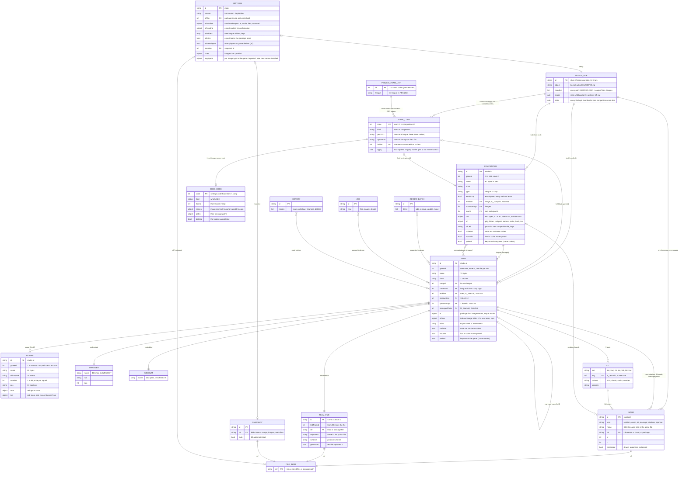

# Database rules: PES 2021 Option Studio

These rules describe how the studio stores its data. Every change to storage, import, export, update or health-check code
must keep them. They come from the decisions the user made in earlier sessions (7–17 November 2026) and from the game's
own file formats. When code and a rule disagree, the rule wins: fix the code, and search for the same mistake elsewhere.

The full behaviour rule book is the `pes21-rules` skill (`.claude/skills/pes21-rules/SKILL.md`). This document covers
the data side only: what is stored, how records link to each other, and how data flows in and out.

---

## 1. The model in one paragraph

The database starts from an **uploaded option file**, the same one that is installed in the game. Building from it
creates a team for every `.ted`, a competition for every `.ced`, and an image record for every PNG those files name.
After that, the studio stores only **your changes** on top of that starting point. Exports turn the database back into
the option file's own file set: the complete set (*First install*) or only the files that differ from the last install
(*Changes only*).

```
Option file (ZIP) ──Build──▶ Studio database ──edits, look-ups, Review──▶ Studio database ──Export──▶ USB file set
   (.ted .ced .png)          (teams, comps, images,                         (changes saved,            (same folders,
                              team files, players)                           one record each)           same names)
```

## 2. The entities and how they link

| Entity | Stored as | Its game file | Its images |
|---|---|---|---|
| **Competition** | `comps/<id>` record | `.ced` (852 bytes), kept on the record (`c.ced`) | Emblem (`c.emblem`), sponsor boards (`c.sponsorImgs`) |
| **Team** | `teams/<id>` record | `.ted` (14,820 bytes), in `teds/<team id>` | Crest (`emblem`), 5 kits (`kits[].img`), stadium (`stadiumImg`), 3 sponsor boards (`sponsorImgs`), manager photo (`managerPhoto`) |
| **Player** | Inside the team record (`t.players[]`) | A 312-byte entry in the team's `.ted` squad block | None (the game draws faces from its own data) |
| **Manager** | Inside the team record (`t.manager`) | Name at `.ted` offset 677 | Manager photo (`t.managerPhoto`, name at offset 723) |
| **Stadium** | Inside the team record (`t.stadium` name) | Name at `.ted` offset 178 | Stadium image (`t.stadiumImg`, name at offset 536) |
| **Sponsors** | Inside the team record (`t.sponsorImgs[3]`, kit `sponsor` text) | Names at `.ted` offsets 569 / 602 / 635 | 3 sponsor boards, 256 × 128 |
| **Image** | `images/<id>` record + the file itself (blob or package reference) | Named inside a `.ted` or `.ced` | — |

The full structure: every collection the studio stores, the fields that link records, and the game's limits on each
field. `PK` is the record key, `FK` a link to another record. Players, the manager, the stadium and the kits live inside
the team record; images and team files are records of their own that point at a stored file or a package file.



How to read the links:
- **A league club** has one league (`t.compId`); **cups** list their participants (`c.teams`). In the game the league is
  the team slot (`t.gameId`); competition files hold no team lists.
- **Images** are linked only by the names inside the team and competition files; the record fields mirror those names.
  Names follow the game ID on export (`E_`, `M_`, `K_` + team ID, `C_` + competition ID), plain ASCII, 31 characters or fewer.
- **Stored files** (`FILE_BLOB`): `l:` in this browser, `a:` in the cloud, `o:<package>|<path>` a file read from the option
  file itself and never copied.
- **Game codes** (page in the menu): every team and competition sits at a code. `GAME_CODE` is not stored as its own record:
  the page builds it from PES 2021's team list (`assets/pes21-teams.json`), the option file's team and competition files and
  the codes the studio's records hold. One table per kind: **Code · In PES · In Option File · Your Update · [Apply]**. *Your
  Update* lists the holder now, *— Free —* and every team or competition without a place in the game (no code, or a code the
  game doesn't have); choosing another and pressing *Apply* gives it the code (`codeSet`, written into its file at export) and
  the old holder gets `noCode` (left out of exports until it gets another). The Competitions and Teams lists tag each one "In
  the game · code" or "No place in the game" with *Allocate a slot*, which opens this page.
- **The export record**: `settings.ofPending` holds what the last export wrote until you confirm PES imported it; then it
  becomes `settings.ofInstalled` and the teams' and competitions' `inst` marks.

### Link rules

1. **Game files are the links.** A PNG is a crest, kit, stadium, sponsor board or manager photo only because a `.ted`
   or `.ced` names it. The record fields above mirror those names. Never decide what a file is from its own name or
   folder when a game file names it; name and folder guesses are for loose images only.
2. **Every team and every competition has exactly one game file.** No team or competition exists without its
   `.ted` / `.ced` (imported, from the option file, or generated). A real file always replaces a generated one.
3. **A player belongs to a team by sitting in its squad.** The same footballer at his club and in his national team is
   two records with the same game ID. That is not a duplicate, and nothing moves a player between the two.
4. **A league club belongs to one league** (`t.compId`). **Cups only add participants** (`c.teams`) and never change a
   club's league. A cup copy of a club shares its league copy's team ID, player IDs and game file, and links to it by id (`sameAsId`).
   - **Importing puts a club in the league of its team slot.** Competition files hold no team lists (checked on all 53 files
     of the 2026-27 option file: ID, name, stage names and emblem only). Each slot belongs to a league in the game's own
     database, and cups draw from the leagues.
   - **Any club can be moved to any league.** The game's leagues are set by hand in Edit → Competition Structure (option
     files ship league-order pictures for it); importing never moves a club. The studio lists the moves to make there
     (`csPlan`, "Competition Structure in the game"). It can join any cup (`c.teams`).
5. **There is always one World Cup** holding every national team. It cannot be deleted, and national teams cannot be
   removed from it.
6. **Image names follow the game ID** on export (`E_/M_/K_<team id>`, `C_<comp id>`), plain ASCII, 31 characters or fewer.

## 3. IDs

| ID | What it is | Rule |
|---|---|---|
| Studio id (`id`) | Internal record key | Unique in its collection. Links between records use it, never a name. |
| Team game ID (`t.gameId`) | The PES team slot | Never 0, never shared by two team files. Option-file slots are adopted; a new team takes a free slot, else a random unused number in the team range. The game only overwrites teams it has: a code it doesn't have is skipped on import (both exports say so). |
| Competition game ID (`c.gameId`) | The PES competition number | Never 0. A new one is a random unused number up to 199, avoiding known IDs, and has no place in the game until it gets a game competition's code. The file's slot index (2 bytes at 104) always goes with the code (`cedSetCode`, `COMP_SLOT`); a file whose code the game doesn't have, or whose slot is another code's, is never written (`cedProblem`). |
| Player game ID (`p.gameId`) | The PES player ID | 1 to 4,294,967,295. Never 0, once per squad. Real players keep Konami's ID; created players get an edit ID (0x40080000–0x400EFFFF) that stays the same on every export, but the game never creates a player from a team file and refuses a team that lists one it doesn't have, so exports leave them out unless *Also write players no game file has* is ticked (for IDs the game already has, such as unregistered players). |

Codes can be moved on the *Game codes* page: the record given a code holds it (`codeSet`), the one that held it gets no code
(`noCode`) and is left out of exports until it gets another. Nothing ever makes up a code for a `noCode` record.

A competition that loses its slot there asks: **keep** it and its league clubs (`noCode` + `parked`: in the studio, out of every
export and the health check) or **delete** them (competition, clubs, cup copies, players and images; snapshot first). Every code
a record loses goes into the code book (`settings.codeBook[kind][code]`: who held it and the image names and paths the game has
there), so a deleted holder's names stay usable. A code no record holds is free (Game codes → *Free codes*); the record given it
writes all its images under the book's names at export (`codeImgName`). An option-file record given another code than its own
file's (`codeMoved`) is exported like a new one under that code's names; its own old file is deleted (left out of First
install, listed to delete in CHANGES.txt) and its old code goes into the code book as a free code.

## 4. Saving changes

1. **One record per team, competition, image, team file and setting.** A change saves only the records it touched,
   never the whole project.
2. **Package images are never copied.** An option-file image is stored as a reference, `o:<package>|<path>`. Only
   images you add or the studio draws are stored as files (`l:` in this browser, `a:` in the cloud).
3. **Generated images are marked** (`generated: true`), so a real image found later replaces them.
4. **Every change is undoable.** Big operations (build, restore, merge, delete team, apply all) take a snapshot
   first; edits are recorded in the change history.
5. **Look-ups never write directly.** Free-source pulls and Claude updates put their results in Review changes;
   only coded fixes (numbers, duplicates, IDs, short names, name shortening) apply on the spot.
6. **Updates only add or change what the source covers.** A team a season leaves out is kept as it is, with its
   players and memberships. A missing-details fill writes only empty fields.
7. **The site's baseline is one option file, the same for everyone.** The owner uploads it to the site's packages
   (`optionfiles/` in the bucket) and chooses it (`optionfile.baseline()`, `set_baseline`; else the newest site package).
   Every visitor and account reads the site's packages (read-only, no sign-in needed) and an empty project starts from
   it (`firstRunChoice`, `buildFromSiteBaseline`); Overview says when a project was built from another option file.
   There is no published project baseline any more: setting a snapshot as baseline only marks it in that project.
   Other signed-in accounts can still upload their own option file (`users/<id>/optionfiles/`, seen by no one else).
   Review queue, jobs, history and settings always stay private to the project.

## 5. Building from the option file

1. **The option file is what the game has.** Once loaded, "which team or competition is this in the game" is answered
   from it (`inGameTeam` / `inGameComp`), never from PES's default teams.
2. **A build starts over with a clean slate.** Whether from the site's baseline or the user's own upload, the whole
   project is deleted first: every collection (snapshots included), the files it stored and the `pes21.*` lookup caches
   (`startFresh` → `wipeProject`; online `POST /api/wipe` → `cloud.wipe_project`, which keeps `users/<id>/optionfiles/`).
   The page reloads empty and `finishFresh` builds from the option file alone. Nothing is merged; `ofBuild` refuses a
   project that still has teams.
3. **Only the main USB part is read.** An option file can ship more than one USB folder. The main one holds most team
   files ("USB 1"); the others are add-ons that reuse its team slots and competition IDs (in 2026-27, USB 2 Liga MX
   and USB 3 Liga 1 Peru both replace MLS's competitions 51 and 54 and 13 of the same 18 slots). Add-ons are left
   out of the build and the export (`ofScope`).
4. **One team per team slot, from the file that counts.** Inside the main part the numbered folders (1 … 7) are
   imported in order, so for a slot with two files the later part wins (Charlotte over Jobazavar at 4040, Le Mans
   over Sheriff at 4240). The build takes that file (`ofPart`, last one wins).
5. **One competition file per competition.** A competition that took a file in a build never takes a second
   (FIFA World Cup and FIFA Club World Cup stay two).
6. **The starting state is recorded** per team and competition (`of.hash`, `of.img0`, `fileHash0`).
   The automatic steps after a build run before the baseline snapshot, so a fresh build shows no changes.
7. **An empty image name means the game's own image.** The team file marks it too: crest number 0xFFFF (team block +8),
   stadium number 0xFFFF (+12), an all-zero kit header before a kit name. Giving such a slot an image switches the marker as
   well (rule book, "PES default images"). A team file that names no crest keeps the game's built-in crest;
   the studio draws none for it, national teams included (a flag only when you choose "Use flag"). A league folder without a competition file is one
   of the game's own competitions and gets no file, ID or logo (`ofGameCrest`, `ofGameComp`).

## 6. Exporting

1. **One export, one USB folder.** The game imports every file of one kind from the USB in one go (team files, then
   competition files, then images) and links them by the names inside them; folders don't matter to it, but the
   export keeps the option file's own. The export is the main USB part with its folders and names. Credits, help
   images, league order and `CHANGES.txt` sit at the top, next to it.
2. **Every file of the option file stays.** Where the option file has two files for one team slot (an earlier part's
   and a later part's), both are kept; the team is built from the later one, and when it changes both files are rewritten
   with the same data, so the game gets the same team whichever it imports last. An untouched project exports the option
   file exactly (2,639 of 2,639 files for the 2026-27 file) and shows no changes.
3. **Same names, same places.** Unedited files are copied byte for byte. Edited team files are rebuilt from their
   originals and keep their image names; an edited image replaces the file of the same name. A new image of a package
   team gets a name in the team's folder, kept on the team (`t.of.names` / `t.of.paths`) so every export writes the same name.
4. **New data goes into the option file's own folders.** A new team goes into its league's folder (`Teds…/` and
   `Images/<Team>/`), or into one new league folder per competition, numbered after the option file's last one and kept
   in `settings.ofFolders`, so adding or deleting a competition never moves a team. A new competition file goes into the
   option file's competitions folder, numbered after its last file (`c.ofCed`). A team with no squad still gets a
   team-info file.
5. **Deleted means left out.** A team or competition deleted in the studio is left out of *First install*, with the
   images only its file named. *Changes only* can't delete files, so `CHANGES.txt` lists the files to delete from the
   installed copy. The game keeps what was last imported into a slot.
5a. **Images named by no file are left out unless you ask for them.** "Don't include images named by no file" (on by
   default, `settings.ofNoOrphans`, off only when `false`) drops every package image that no team or competition file
   names (in the package, or in the team's or competition's `of.paths`); the game never shows them. They aren't deletions:
   `CHANGES.txt` doesn't list them and the layout check doesn't count them missing. Untick it to get the option file's
   file set exactly. Each export card shows the export's size (about, from a dry plan; exact after a check or export).
   Health check lists them and can allocate one to a free slot of its team or competition (an image record that refers to
   the package file, `o:<package>|<path>`, never a copy); the export then writes it under the team's own image name, so its
   team file names it. A stadium or sponsor board that isn't the package's own counts in `ofHash` (via `ofExtraImgs`) only
   when there is one, so a fresh build keeps its hash. Deleted or ignored ones are kept per package in
   `settings.ofOrphan` (`<package>|<path>` → `del` / `ign`); a deleted one is left out even with the option off.
6. **The baseline moves only when you say so.** Writing an export records what it wrote (`settings.ofPending`, a blob)
   but changes nothing else. Only after PES has imported it do you confirm, through two warnings, and it becomes the
   baseline (`ofApplyInstall`: `of.inst`, `imgInst`, `fileInst`, `settings.ofInstalled`). Until then the previous
   option file or confirmed export stays the baseline, and *Changes only* compares with it. Building from a package
   while an export waits asks once more (the build deletes the project, so that export's changes are gone).
7. **Game files are written only through `TED.build` / `TED.encrypt` / `CED.build`**, so the size and hash are right.
8. **The connection check reads every file back** before download and blocks on broken links, duplicate team IDs or
   missing images.
8a. **Image space.** Each image type has its own store in the game; the game's own images take no space, imported ones do.
   An image whose name is already in the game is overwritten in place; a new name takes a space. The export card shows,
   per type, the option file's images, the free spaces entered from the game (`settings.imgSpace.free`), room in all, and
   what the export adds; confirming an export takes what it added off the free spaces and records its new names
   (`settings.imgSpace.inst`). No placeholder manager photo, stadium or sponsor board is drawn: the game shows its own.
9. **Game limits are enforced before writing:** 40 players at most, numbers 1–99 once each, ratings 40–99,
   names 60 bytes, shirt names 16 letters, short names 3 capitals, image sizes per kind.

## 7. Deleting

1. **Deleting a record removes every link to it.** Deleting a team removes it from every `c.teams` list and deletes
   its team file. Deleting an image clears every field that points at it (crest, kits, manager photo, stadium,
   sponsor boards, competition emblem and boards). Deleting a competition unassigns its teams.
2. **Deleting a team is undoable** from the snapshot taken first.
3. **Package files are never deleted**; only the reference to them goes.

---

## Fixes made against these rules (18 November 2026)

When this document was written, the code broke some of the rules. These are now fixed; keep them fixed.

| # | Was | Now | Where |
|---|---|---|---|
| 1 | Deleting a team left its team file and its id in cup `c.teams` lists. | `dropTeam` removes both and records them in the change history, so undo brings the team back with its file and its cups. Merging cup copies uses the same delete. | `dropTeam`, `ACT.delTeam`, `ACT.mergeDups`, `undoEntries` |
| 2 | Deleting an image left stadium and sponsor-board fields pointing at it. | `unlinkImages` clears every image field of every team and competition. | `unlinkImages`, `ACT.delImg` |
| 3 | Snapshots held teams, competitions and images but not team files, and restoring brought back only teams and competitions. | Snapshots hold team files too. Restoring brings back images whose file is still stored and the snapshot's team files, then clears any link to an image that is gone. A snapshot taken before this change keeps the current team files of the teams it has. | `takeSnapshot`, `ACT.snapRestore`, `packBaseline` |
| 4 | A cup copy found its league club by name (`sameAs`). | It links by id (`sameAsId`); `sameAs` is only the name shown. Older copies are linked by name once, at start-up. | `leagueCopy` |
| 5 | The export's fallback edit-player ID was checked for clashes within one squad only. | It also avoids every player game ID used anywhere in the project. Players given IDs by the studio already got project-wide unique ones (`assignIds`). | `usedPlayerIds`, team-file export |

Checked and kept as designed: a player's game ID (`p.gameId`, written to the game) and his team-file link (`p.ted.pid`, the
record his data came from) can differ on purpose. The health check flags the difference per team ("linked to a different
game record than his game ID") with *Use the game ID*.
