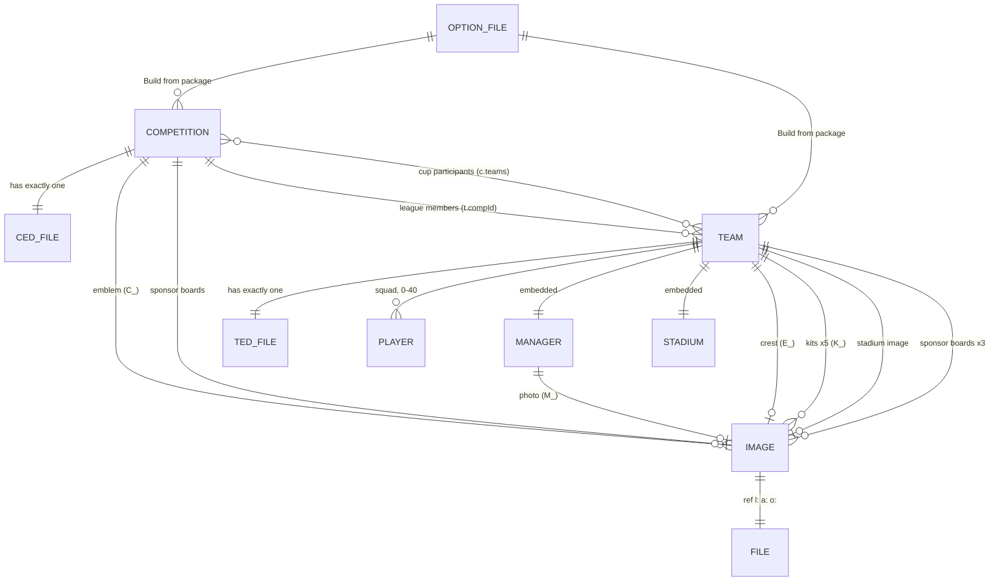

# Database rules: PES 2021 Option Studio

These rules describe how the studio stores its data. Every change to storage, import, export, update or health-check code
must keep them. They come from the decisions the user made in earlier sessions (7–17 November 2026) and from the game's
own file formats. When code and a rule disagree, the rule wins: fix the code, and search for the same mistake elsewhere.

The full behaviour rule book is the `pes21-rules` skill (`.claude/skills/pes21-rules/SKILL.md`). This document covers
the data side only: what is stored, how records link to each other, and how data flows in and out.

---

## 1. The model in one paragraph

The database starts from an **uploaded option file**, the same one that is installed in the game. Building from it
creates a team for every `.ted`, a competition for every `.ced`, and an image record for every PNG those files name.
After that, the studio stores only **your changes** on top of that starting point. Exports turn the database back into
the option file's own file set: the complete set (*First install*) or only the files that differ from the last install
(*Changes only*).

```
Option file (ZIP) ──Build──▶ Studio database ──edits, look-ups, Review──▶ Studio database ──Export──▶ USB file set
   (.ted .ced .png)          (teams, comps, images,                         (changes saved,            (same folders,
                              team files, players)                           one record each)           same names)
```

## 2. The entities and how they link

| Entity | Stored as | Its game file | Its images |
|---|---|---|---|
| **Competition** | `comps/<id>` record | `.ced` (852 bytes), kept on the record (`c.ced`) | Emblem (`c.emblem`), sponsor boards (`c.sponsorImgs`) |
| **Team** | `teams/<id>` record | `.ted` (14,820 bytes), in `teds/<team id>` | Crest (`emblem`), 5 kits (`kits[].img`), stadium (`stadiumImg`), 3 sponsor boards (`sponsorImgs`), manager photo (`managerPhoto`) |
| **Player** | Inside the team record (`t.players[]`) | A 312-byte entry in the team's `.ted` squad block | None (the game draws faces from its own data) |
| **Manager** | Inside the team record (`t.manager`) | Name at `.ted` offset 677 | Manager photo (`t.managerPhoto`, name at offset 723) |
| **Stadium** | Inside the team record (`t.stadium` name) | Name at `.ted` offset 178 | Stadium image (`t.stadiumImg`, name at offset 536) |
| **Sponsors** | Inside the team record (`t.sponsorImgs[3]`, kit `sponsor` text) | Names at `.ted` offsets 569 / 602 / 635 | 3 sponsor boards, 256 × 128 |
| **Image** | `images/<id>` record + the file itself (blob or package reference) | Named inside a `.ted` or `.ced` | — |



### Link rules

1. **Game files are the links.** A PNG is a crest, kit, stadium, sponsor board or manager photo only because a `.ted`
   or `.ced` names it. The record fields above mirror those names. Never decide what a file is from its own name or
   folder when a game file names it; name and folder guesses are for loose images only.
2. **Every team and every competition has exactly one game file.** No team or competition exists without its
   `.ted` / `.ced` (imported, from the option file, or generated). A real file always replaces a generated one.
3. **A player belongs to a team by sitting in its squad.** The same footballer at his club and in his national team is
   two records with the same game ID. That is not a duplicate, and nothing moves a player between the two.
4. **A league club belongs to one league** (`t.compId`). **Cups only add participants** (`c.teams`) and never change a
   club's league. A cup copy of a club shares its league copy's team ID, player IDs and game file, and links to it by id (`sameAsId`).
5. **There is always one World Cup** holding every national team. It cannot be deleted, and national teams cannot be
   removed from it.
6. **Image names follow the game ID** on export (`E_/M_/K_<team id>`, `C_<comp id>`), plain ASCII, 31 characters or fewer.

## 3. IDs

| ID | What it is | Rule |
|---|---|---|
| Studio id (`id`) | Internal record key | Unique in its collection. Links between records use it, never a name. |
| Team game ID (`t.gameId`) | The PES team slot | Never 0, never shared by two team files. Option-file slots are adopted; a new team takes a free slot, else a random unused number in the team range. |
| Competition game ID (`c.gameId`) | The PES competition number | Never 0. A new one is a random unused number up to 199, avoiding known IDs. |
| Player game ID (`p.gameId`) | The PES player ID | 1 to 4,294,967,295. Never 0, once per squad. Real players keep Konami's ID; created players get an edit ID (0x40080000–0x400EFFFF) that stays the same on every export. |

## 4. Saving changes

1. **One record per team, competition, image, team file and setting.** A change saves only the records it touched,
   never the whole project.
2. **Package images are never copied.** An option-file image is stored as a reference, `o:<package>|<path>`. Only
   images you add or the studio draws are stored as files (`l:` in this browser, `a:` in the cloud).
3. **Generated images are marked** (`generated: true`), so a real image found later replaces them.
4. **Every change is undoable.** Big operations (build, restore, merge, delete team, apply all) take a snapshot
   first; edits are recorded in the change history.
5. **Look-ups never write directly.** Free-source pulls and Claude updates put their results in Review changes;
   only coded fixes (numbers, duplicates, IDs, short names, name shortening) apply on the spot.
6. **Updates only add or change what the source covers.** A team a season leaves out is kept as it is, with its
   players and memberships. A missing-details fill writes only empty fields.
7. **Only game data goes public.** Teams, competitions, players, images and team files can go into a baseline;
   review queue, jobs, history and settings stay private. Projects built from a package are for signed-in accounts only.

## 5. Building from the option file

1. **The option file is what the game has.** Once loaded, "which team or competition is this in the game" is answered
   from it (`inGameTeam` / `inGameComp`), never from PES's default teams.
2. **Its data comes first.** The project's own data fills only gaps. Teams the option file lacks stay, under their own
   slots; a game ID the package uses is taken back from any outside team.
3. **The starting state is recorded** per team and competition (`of.hash`, `of.img0`, `fileHash0`), and the state of
   each install (`of.inst`, `imgInst`, `fileInst`). *Changes only* compares against the last install.

## 6. Exporting

1. **Same file set, same folders, same names** as the option file. Edited team files are rebuilt from their originals,
   keeping their image names.
2. **Game files are written only through `TED.build` / `TED.encrypt` / `CED.build`**, so the size and hash are right.
3. **The connection check reads every file back** before download and blocks on broken links, duplicate team IDs or
   missing images.
4. **Game limits are enforced before writing:** 40 players at most, numbers 1–99 once each, ratings 40–99,
   names 60 bytes, shirt names 16 letters, short names 3 capitals, image sizes per kind.

## 7. Deleting

1. **Deleting a record removes every link to it.** Deleting a team removes it from every `c.teams` list and deletes
   its team file. Deleting an image clears every field that points at it (crest, kits, manager photo, stadium,
   sponsor boards, competition emblem and boards). Deleting a competition unassigns its teams.
2. **Deleting a team is undoable** from the snapshot taken first.
3. **Package files are never deleted**; only the reference to them goes.

---

## Fixes made against these rules (18 November 2026)

When this document was written, the code broke some of the rules. These are now fixed; keep them fixed.

| # | Was | Now | Where |
|---|---|---|---|
| 1 | Deleting a team left its team file and its id in cup `c.teams` lists. | `dropTeam` removes both and records them in the change history, so undo brings the team back with its file and its cups. Merging cup copies uses the same delete. | `dropTeam`, `ACT.delTeam`, `ACT.mergeDups`, `undoEntries` |
| 2 | Deleting an image left stadium and sponsor-board fields pointing at it. | `unlinkImages` clears every image field of every team and competition. | `unlinkImages`, `ACT.delImg` |
| 3 | Snapshots held teams, competitions and images but not team files, and restoring brought back only teams and competitions. | Snapshots hold team files too. Restoring brings back images whose file is still stored and the snapshot's team files, then clears any link to an image that is gone. A snapshot taken before this change keeps the current team files of the teams it has. | `takeSnapshot`, `ACT.snapRestore`, `packBaseline` |
| 4 | A cup copy found its league club by name (`sameAs`). | It links by id (`sameAsId`); `sameAs` is only the name shown. Older copies are linked by name once, at start-up. | `leagueCopy` |
| 5 | The export's fallback edit-player ID was checked for clashes within one squad only. | It also avoids every player game ID used anywhere in the project. Players given IDs by the studio already got project-wide unique ones (`assignIds`). | `usedPlayerIds`, team-file export |

Checked and kept as designed: a player's game ID (`p.gameId`, written to the game) and his team-file link (`p.ted.pid`, the
record his data came from) can differ on purpose. The health check flags the difference per team ("linked to a different
game record than his game ID") with *Use the game ID*.
