# Database rules: PES 2021 Option Studio

These rules describe how the studio stores its data. Every change to storage, import, export, update or health-check code
must keep them. They come from the decisions the user made in earlier sessions (7–17 November 2026) and from the game's
own file formats. When code and a rule disagree, the rule wins: fix the code, and search for the same mistake elsewhere.
Last brought up to date on 21 November 2026.

The full behaviour rule book is the `pes21-rules` skill (`.claude/skills/pes21-rules/SKILL.md`). This document covers
the data side only: what is stored, how records link to each other, and how data flows in and out.

---

## 1. The model in one paragraph

The database starts from an **uploaded option file**, the same one that is installed in the game. Building from it
creates a team for every `.ted`, a competition for every `.ced`, and an image record for every PNG those files name.
Each club goes into the league of its **team slot in the game** (PES 2021's team list); a game league with no `.ced`
becomes a competition of its own. The option file's folders decide nothing about what a record is or where it belongs.
After that, the studio stores only **your changes** on top of that starting point. Exports turn the database back into
the option file's own file set: the complete set (*First install*) or only the files that differ from the last install
(*Changes only*).

```
Option file (ZIP) ──Build──▶ Studio database ──edits, look-ups, Review──▶ Studio database ──Export──▶ USB file set
   (.ted .ced .png)          (teams, comps, images,                         (changes saved,            (same folders,
                              team files, players)                           one record each)           same names)
```

## 2. The entities and how they link

| Entity | Stored as | Its game file | Its images |
|---|---|---|---|
| **Competition** | `comps/<id>` record | `.ced` (852 bytes), kept on the record (`c.ced`) | Emblem (`c.emblem`), sponsor boards (`c.sponsorImgs`) |
| **Team** | `teams/<id>` record | `.ted` (14,820 bytes), in `teds/<team id>` | Crest (`emblem`), 5 kits (`kits[].img`), stadium (`stadiumImg`), 3 sponsor boards (`sponsorImgs`), manager photo (`managerPhoto`) |
| **Player** | Inside the team record (`t.players[]`) | A 312-byte entry in the team's `.ted` squad block | None (the game draws faces from its own data) |
| **Manager** | Inside the team record (`t.manager`) | Name at `.ted` offset 677 | Manager photo (`t.managerPhoto`, name at offset 723) |
| **Stadium** | Inside the team record (`t.stadium` name) | Name at `.ted` offset 258 (team block +178) | Stadium image (`t.stadiumImg`, name at offset 536) |
| **Sponsors** | Inside the team record (`t.sponsorImgs[3]`, kit `sponsor` text) | Names at `.ted` offsets 569 / 602 / 635 | 3 sponsor boards, 256 × 128 |
| **Supporter banners** | Not stored: read from the team's `.ted` when its page is shown (`TED.banners`) | 4 texts of 16 bytes at `.ted` offsets 439 / 455 / 471 / 487 | None |
| **Player appearance** | Not stored: read from his record when the player editor opens (`TED.look`, experimental) | The 72 bytes at 240 of his 312-byte record | None |
| **Image** | `images/<id>` record + the file itself (blob or package reference) | Named inside a `.ted` or `.ced` | — |

Offsets count from the start of the unmasked file (the 80-byte header included), so the team block starts at 80: a
"team block +N" offset in the rule book is file offset 80 + N.

The full structure: every collection the studio stores, the fields that link records, and the game's limits on each
field. `PK` is the record key, `FK` a link to another record. Players, the manager, the stadium and the kits live inside
the team record; images and team files are records of their own that point at a stored file or a package file.

```mermaid
erDiagram
  OPTION_FILE ||--o{ COMPETITION : "built from (c.of)"
  OPTION_FILE ||--o{ TEAM : "built from (t.of)"
  OPTION_FILE ||--o{ IMAGE : "o: references, never copied"
  OPTION_FILE ||--o{ GAME_CODE : "codes in its team and competition files"
  PES2021_TEAM_LIST ||--o{ GAME_CODE : "team codes and their PES 2021 league"
  PES2021_TEAM_LIST ||--o{ COMPETITION : "game league (c.gameLeague)"
  GAME_CODE ||--o{ PLAYER_CODE : "a team file's player records"
  PLAYER_CODE |o--o| PLAYER : "taken over (p.ted, codeSet)"
  SETTINGS |o--o| LOCAL_BACKUP : "this computer only"
  GAME_CODE |o--o| TEAM : "held by (t.gameId)"
  GAME_CODE |o--o| COMPETITION : "held by (c.gameId)"
  GAME_CODE ||--o| CODE_BOOK : "freed: image names kept"
  SETTINGS |o--|| OPTION_FILE : "ofPkg"
  SETTINGS |o--o| SNAPSHOT : "baseline"
  COMPETITION ||--o{ TEAM : "league (t.compId)"
  COMPETITION }o--o{ TEAM : "cup participants (c.teams)"
  TEAM |o--o| TEAM : "cup copy (sameAsId)"
  TEAM ||--|| TEAM_FILE : "teds/team id"
  TEAM ||--o{ PLAYER : "squad 0 to 40"
  TEAM ||--|| MANAGER : "embedded"
  TEAM ||--|| STADIUM : "embedded"
  TEAM ||--o{ KIT : "5 slots"
  TEAM ||--o{ IMAGE : "crest, stadium, 3 boards, manager photo"
  KIT |o--o| IMAGE : "kit texture"
  COMPETITION |o--o{ IMAGE : "emblem, boards"
  IMAGE ||--|| FILE_BLOB : "ref"
  TEAM_FILE ||--|| FILE_BLOB : "ref"
  SNAPSHOT ||--|| FILE_BLOB : "ref"
  SETTINGS |o--o| FILE_BLOB : "ofPending.ref"
  REVIEW_BATCH }o--o{ TEAM : "suggested changes"
  JOB }o--o{ TEAM : "queued look-ups"
  HISTORY }o--o{ TEAM : "undo entries"

  OPTION_FILE {
    string id PK "sha1 of name and size, 12 chars"
    string object "bucket optionfiles/WEPES.zip"
    list manifest "every path: WEPES/1-7/NN. League/Teds, Images"
    rule scope "main USB part only, add-ons left out"
    rule slots "every file kept; two files for one slot get the same data"
  }
  GAME_CODE {
    int code PK "team ID or competition ID"
    string kind "team or competition"
    string pes2021 "name and league there (team codes)"
    string optionFile "name in the option file's file"
    ref holder FK "one team or competition, or free"
    rule apply "Your Update + Apply: holder gets it, old holder loses it"
  }
  CODE_BOOK {
    int code PK "settings.codeBook.team / .comp"
    string from "who held it"
    ref fromId "that record, if kept"
    object names "image names the game has at the code"
    object paths "their package paths"
    list files "the old holder's file paths"
    bool deleted "the holder was deleted"
  }
  PLAYER_CODE {
    int pid PK "a player record in a game team file"
    list files "the team files holding him (second files too)"
    ref holder FK "the squad player written under it, or free"
    object book "settings.codeBook.player: ref, team, name, club"
  }
  LOCAL_BACKUP {
    string file PK "project-backup.zip (LOCAL_BACKUP_DIR)"
    list holds "teams, comps, team files, own images, settings, review, history, baseline snapshot"
    rule when "3 minutes after a change, on request; offered when the project opens empty"
  }
  PES2021_TEAM_LIST {
    int id PK "725 team codes (PES Master)"
    string league "its league in PES 2021"
  }
  SETTINGS {
    string id PK "main"
    string season "turns over 1 September"
    ref ofPkg FK "package in use and when built"
    object ofInstalled "confirmed export: at, mode, files, removed"
    object ofPending "export waiting for confirmation"
    map ofFolders "new league folders, kept"
    bool ofExtra "export teams and competitions the package lacks"
    bool ofNewPlayers "write players no game file has (off)"
    bool ofNoOrphans "leave out images named by no file (on)"
    map ofOrphan "package image deleted or ignored"
    object codeBook "freed team, comp and player codes"
    map imgCodes "an image renamed to a free image name"
    bool slotLeagues "clubs placed by team slot (one-time move done)"
    ref baseline FK "snapshot id"
    object sizes "image sizes per kind"
    object imgSpace "per image type in the game: imported, free; new names installed"
  }
  COMPETITION {
    string id PK "studio id"
    int gameId "1 to 199, never 0"
    string name "61 bytes in .ced"
    string short
    string type "League or Cup (cups, play-offs, super cups)"
    string gameLeague "the PES 2021 league it stands for"
    bool worldCup "exactly one, every national team"
    ref emblem FK "image, C_ comp id, 256x256"
    list sponsorImgs FK "images"
    list teams FK "cup participants"
    object ced "852 bytes, ID at 80, name 114, emblem 804"
    object of "pkg, ced path, export folder, names, paths, hash, inst"
    string ofCed "path of a new competition file, kept"
    bool codeSet "code set on Game codes"
    bool noCode "lost its code: not exported"
    bool parked "kept out of the game (Game codes)"
  }
  TEAM {
    string id PK "studio id"
    int gameId "team slot, never 0, one file per slot"
    string name "70 bytes"
    string short "3 capitals"
    ref compId FK "its one league: its team slot's"
    ref sameAsId FK "league club of a cup copy"
    ref emblem FK "crest, E_ team id, 256x256"
    ref stadiumImg FK "1024x512"
    list sponsorImgs FK "3 boards, 256x128"
    ref managerPhoto FK "M_ team id, 256x256"
    object of "package link, second files, image names, removed names (cleared), export marks"
    object ofNew "ted and image folder of a new team, kept"
    string ofInst "export mark of a new team"
    bool codeSet "code set on Game codes"
    bool noCode "lost its code: not exported"
    bool parked "kept out of the game (Game codes)"
    string efId "eFootball team it was pulled from"
    string tmId "Transfermarkt dataset club"
    string wpTitle "English Wikipedia article its squad comes from"
  }
  TEAM_FILE {
    string id PK "same as team id"
    int tedTeamId "team ID inside the file"
    string ref FK "blob or package file"
    string origName "name in the option file"
    string scheme "position scheme"
    bool generated "a shell: its players are not in the game"
  }
  PLAYER {
    string id PK "studio id"
    int gameId "1 to 4294967295; edit 0x40080000+"
    string name "60 bytes"
    string shirtName "16 letters"
    int number "1 to 99, once per squad"
    string pos "13 positions"
    object attrs "ratings 40 to 99"
    object ted "pid, team, slot, record it came from"
    bool codeSet "code given on Game codes, Players"
    object codeWas "gameId and ted before the code was given"
  }
  MANAGER {
    string name "46 bytes, ted offset 677"
    string nat
    int age
  }
  STADIUM {
    string name "120 bytes, ted offset 258"
  }
  KIT {
    string slot "1st, 2nd, GK 1st, 3rd, GK 2nd"
    ref img FK "K_ team id, 2048x2048"
    string colours "shirt, shorts, socks, number"
    string sponsor
  }
  IMAGE {
    string id PK "studio id"
    string kind "emblem, comp, kit, manager, stadium, sponsor, extra (a file kept at its package path, incl. imported files that match nothing)"
    string name "33-byte name field in the game file"
    string ref FK "l: browser, a: cloud, o: package"
    int w
    int h
    bool generated "drawn; a real one replaces it"
  }
  FILE_BLOB {
    string ref PK "l: or a: stored file, o: package path"
  }
  SNAPSHOT {
    string id PK
    string ref FK "blob: teams, comps, images, team files"
    bool auto "20 automatic kept"
  }
  REVIEW_BATCH {
    string id PK
    list items "add, remove, update, move"
  }
  JOB {
    string id PK
    string type "free, claude, details"
  }
  HISTORY {
    string id PK
    list entries "team and player changes, deletes"
  }
```



How to read the links:
- **A league club** has one league (`t.compId`); **cups** list their participants (`c.teams`). In the game the league is
  the team slot (`t.gameId`); competition files hold no team lists.
- **Images** are linked only by the names inside the team and competition files; the record fields mirror those names.
  Names follow the game ID on export (`E_`, `M_`, `K_` + team ID, `C_` + competition ID), plain ASCII, 31 characters or fewer.
- **Stored files** (`FILE_BLOB`): `l:` in this browser, `a:` in the cloud, `o:<package>|<path>` a file read from the option
  file itself and never copied.
- **Game codes** (page in the menu): every team and competition sits at a code. `GAME_CODE` is not stored as its own record:
  the page builds it from PES 2021's team list (`assets/pes21-teams.json`), the option file's team and competition files and
  the codes the studio's records hold. One table per kind: **Code · In PES · In Option File · Your Update · [Apply]**. *Your
  Update* lists the holder now, *— Free —* and every team or competition without a place in the game (no code, or a code the
  game doesn't have); choosing another and pressing *Apply* gives it the code (`codeSet`, written into its file at export) and
  the old holder gets `noCode` (left out of exports until it gets another). The Competitions and Teams lists tag each one "In
  the game · code" or "No place in the game" with *Allocate a slot*, which opens this page.
- **Player codes** (Game codes → Players): a player's code is his game ID, and the game has a player only when a team file
  has a record under that ID. The codes are not stored: the page reads them from the team files (the studio's `TEAM_FILE`s and
  the baseline snapshot's, so clubs deleted since still count). A player no game file has is given the code of a player the
  game has that no squad uses: that sets `ted` (`pid`, the file's team ID, slot -1), `gameId` and `codeSet`, and keeps the old
  values in `codeWas`. `settings.codeBook.player[pid]` keeps where the record is (`ref`, `team`, `name`, `club`), so the export
  finds it after that club is deleted. A team given a code takes over the free players at that code in the same step.
  A team slot's second file counts too (its players are in the game), and so do the files of teams deleted since (the code
  book keeps their paths). A **generated** team file does not count: it is only a shell to write into, and its records are
  made up. A player who **has** an ID that no file holds is never given another player's code by suggestion: the health check
  looks his team up (free sources, then Claude; the answers are kept in the browser's `localStorage`, `pes21.pfFind.<season>`,
  keyed by player, and are not part of the project) and links him to the record he has there; otherwise he is moved or
  removed by hand. "Has an ID" means an ID a game file holds a player under: a number only a source gave him (eFootball's ID for a player the
  option file doesn't have) and an edit ID the studio made up (0x40080000–0x400EFFFF) both count as no ID here. Health check → *Allocate free codes* gives every player without an ID his suggested free code at once; when
  none is left, the *Make room* popup lists the teams and competitions whose deletion would free the most codes (codes only their
  squads use); after each delete it opens again with the new numbers. Players taken off a shared game ID (`codeOff`) are given
  an available ID in the same step (`sharedApply` → `codesFor`).
- **The export record**: `settings.ofPending` holds what the last export wrote until you confirm PES imported it; then it
  becomes `settings.ofInstalled` and the teams' and competitions' `inst` marks, and its snapshot (`ofPending.snap`)
  becomes the baseline snapshot (`settings.baseline`).

### Link rules

1. **Game files are the links.** A PNG is a crest, kit, stadium, sponsor board or manager photo only because a `.ted`
   or `.ced` names it. The record fields above mirror those names. Never decide what a file is from its own name or
   folder when a game file names it; name and folder guesses are for loose images only.
2. **Every team and every competition has exactly one game file.** No team or competition exists without its
   `.ted` / `.ced` (imported, from the option file, or generated). A real file always replaces a generated one.
3. **A player belongs to a team by sitting in its squad.** The same footballer at his club and in his national team is
   two records with the same game ID. That is not a duplicate, and nothing moves a player between the two.
4. **A league club belongs to one league** (`t.compId`). **Cups only add participants** (`c.teams`) and never change a
   club's league. A cup copy of a club shares its league copy's team ID, player IDs and game file, and links to it by id (`sameAsId`).
   - **Pool leagues** (AFC Champions League, the game's "other teams" pools; `POOL_LEAGUES`, `isPoolComp`) are leagues: their
     clubs are teams of their own (`compId`), never cup copies, even when the same club plays in a domestic league. A pool club
     with a namesake in a league the game does not have can be updated from it (`twinCopy`): name, short name, country,
     stadium, images, formation, colours, manager, kits, and the squad as new player records (new `id`, no `ted` / `gameId`,
     `codeOff`), then `twinCodes` gives each a code through the player-code planner. `twinOf` / `twinAt` / `twinSig` record the source and its state then, so the pair is offered again only when the league team changes. A cup's team with a code of its own is updated the same way (`cupTwins`). A team's `gameId` is never typed: Team details shows it read-only and it changes only on Game codes.
   - **Importing puts a club in the league of its team slot.** Competition files hold no team lists (checked on all 53 files
     of the 2026-27 option file: ID, name, stage names and emblem only). Each slot belongs to a league in the game's own
     database (`slotLeagueOf`, from `assets/pes21-teams.json`), and cups draw from the leagues. The league's competition is
     the `.ced` whose code stands for it (`LEAGUE_OF_CODE`), else one marked with it (`c.gameLeague`), else a new one named
     after it (`LEAGUE_NAME`), all in `slotComp`. A club whose slot the list doesn't have gets no competition. **The option
     file's folders are never used for this.** A project built while folders decided was moved once (`settings.slotLeagues`):
     clubs the folders placed went to their slot's league, clubs you had moved stayed.
   - **Cups, play-offs and super cups are cups** (`type: 'Cup'`, `CUP_RE`): they hold no league clubs and never appear under
     "Leagues with no teams".
   - **Any club can be moved to any league.** The game's leagues are set by hand in Edit → Competition Structure (option
     files ship league-order pictures for it); importing never moves a club. The studio lists the moves to make there
     (`csPlan`, "Competition Structure in the game"). It can join any cup (`c.teams`).
5. **There is always one World Cup** holding every national team. It cannot be deleted, and national teams cannot be
   removed from it.
6. **Image names follow the game ID** on export (`E_/M_/K_<team id>`, `C_<comp id>`), plain ASCII, 31 characters or fewer.

## 3. IDs

| ID | What it is | Rule |
|---|---|---|
| Studio id (`id`) | Internal record key | Unique in its collection. Links between records use it, never a name. |
| Team game ID (`t.gameId`) | The PES team slot | Never 0, never shared by two team files. Option-file slots are adopted; a new team takes a free code of the game, else it has **no code** (never a made-up number: rule book, "Never a made-up ID"). A new club gets its code only from the popup after an apply (league, then a free code of it: `teamPlaceAsk`); the ID its file carries is kept as `fileTeamId`, a suggestion, until then. The game only overwrites teams it has: a code it doesn't have is skipped on import (both exports say so). |
| Competition game ID (`c.gameId`) | The PES competition number | Never 0, and never made up: a new one has **no code** (and no file) until it gets a game competition's slot. The file's slot index (2 bytes at 104) always goes with the code (`cedSetCode`, `COMP_SLOT`); a file whose code the game doesn't have, or whose slot is another code's, is never written (`cedProblem`). **In the game** means one of the game's own competitions (no file, `ofGameComp`) or a usable slot: a code in the slot table with the file carrying that pair, or a slot allocated on Game codes (`compPlaced`). An ID alone, in a file or set by hand, is no place in the game (tests 21 to 23, 22 November 2026). A **new competition** gets its place only when it is applied from Process and Review or an import: a vacancy of its kind or the slot of a competition it replaces, chosen in a popup, then `codeAssign` (`js/app-comp-add.js`; rule book, "A competition is added one way"). |
| Player game ID (`p.gameId`) | The PES player ID | 1 to 4,294,967,295. Never 0, once per squad. Real players keep Konami's ID (or the option file's edit ID). A player with no game record has **no game ID**, never a made-up one: he gets a free ID the game has (*Allocate free IDs*) and until then is left out of every team file (the game refuses a team that lists a player it doesn't have). The studio made up IDs in 0x40080000–0x400EFFFF before 2026-11-22; they were cleared once and are read as no ID. |

Codes can be moved on the *Game codes* page: the record given a code holds it (`codeSet`), the one that held it gets no code
(`noCode`) and is left out of exports until it gets another. Nothing ever makes up a code for a `noCode` record.

A competition that loses its slot there asks: **keep** it and its league clubs (`noCode` + `parked`: in the studio, out of every
export and the health check) or **delete** them (competition, clubs, cup copies, players and images; snapshot first). Every code the game has
that a record loses goes into the code book (a made-up code is just dropped) (`settings.codeBook[kind][code]`: who held it and the image names and paths the game has
there), so a deleted holder's names stay usable. A code no record holds is free (Game codes → *Free codes*); the record given it
writes all its images under the book's names at export (`codeImgName`). An option-file record given another code than its own
file's (`codeMoved`) is exported like a new one under that code's names, and its old code goes into the code book as a free
code. Only the code and image names are reused: the old file of a code that changed hands is left out of the export (ignored
when kept, removed when deleted) and never listed to delete, since the game can't delete a team or competition file; the new
holder's file has a name of its own (`codeGone` in `ofPlan`; the book keeps the old paths, `files`).

### A team code belongs to one league, for good

Tested in the game on 22 November 2026, in every league and group: a team is listed in the league its **team code**
belongs to, whatever squad or name its file carries. No file holds the link (a competition file has no team list, a team
file no competition), so it cannot be changed. The rules that follow:

1. **Each team code of the game is tied to one league or group of the game** (`slotLeagueOf(code)`, from the game's team
   list). The 20 codes of the PAS League are the BRI SUPER LEAGUE's 20 places, whoever sits on them.
2. **The tie outlives the team.** A deleted team's code goes to the code book as a free code and is still a code of its
   league: it is only ever given to a team of that league.
3. **A competition stands for one game league** (`c.gameLeague`), and a team filed under it (`t.compId`) is a team of that
   league (`teamLeagueKey`).
4. **A team is only offered the codes of its own league, and a code is only offered to teams of its league** (teams filed
   under no league are offered every free code). This holds in Game codes → *Files with no Codes*, in the *Who gets
   this code* list, and in *A code for …*; an Apply with a code of another league is refused (`codeLeagueOk`,
   `codeLeagueStop`).
5. **A league cannot grow.** When every code of a league is held, a new team joins it only by taking the code of a team
   that gives it up.
6. **Filing a team under another league does not move it in the game, so it is not accepted** (rule book, top rule). A
   team is filed only under the league of its code (`t.compId` follows `slotLeagueOf(t.gameId)`). It changes league only by
   a move (`teamMoveTo`): it takes a free code of the new league (`leagueFreeCodes`: free on Game codes, not a licensed
   team's), through `codeAssign` (its old code goes to the code book, rule 2), and is filed under that league's
   competition (`slotComp`, which brings a deleted one back). A licensed, national or cup-copy team doesn't move
   (`teamMoveWhy`). Every place that sets a team's league uses this: *Change competition*, the info tab, *Add or remove
   teams*, Health check → *Teams without a league* (`teamFileUnder`, `nlPlace`). A review batch (Live Update, Claude, an
   import) carries a team's league change only when it is the league of its code, or a cup for a team in no league; any
   other is dropped and named in the batch's notes (`batchFromData`). A team filed elsewhere before this rule
   is still listed by the health check (*Game IDs → Teams*, "is a code of …").

## 4. Saving changes

1. **One record per team, competition, image, team file and setting.** A change saves only the records it touched,
   never the whole project.
2. **Package images are never copied.** An option-file image is stored as a reference, `o:<package>|<path>`. Only
   images you add or the studio draws are stored as files (`l:` in this browser, `a:` in the cloud).
3. **Generated images are marked** (`generated: true`), so a real image found later replaces them.
4. **Every change is undoable.** Big operations (build, restore, merge, delete team, apply all) take a snapshot
   first; edits are recorded in the change history.
5. **Look-ups never write directly.** Free-source pulls and Live Updates put their results in Process and Review;
   only coded fixes (numbers, duplicates, IDs, short names, name shortening) apply on the spot.
6. **Updates only add or change what the source covers.** A team a season leaves out is kept as it is, with its
   players and memberships. A missing-details fill writes only empty fields.
7. **The site's baseline is one option file, the same for everyone.** The owner uploads it to the site's packages
   (`optionfiles/` in the bucket) and chooses it (`optionfile.baseline()`, `set_baseline`; else the newest site package).
   Every visitor and account reads the site's packages (read-only, no sign-in needed) and an empty project starts from
   it (`firstRunChoice`, `buildFromSiteBaseline`); Overview says when a project was built from another option file.
   There is no published project baseline any more: setting a snapshot as baseline only marks it in that project.
   Other signed-in accounts can still upload their own option file (`users/<id>/optionfiles/`, seen by no one else).
   Review queue, jobs, history and settings always stay private to the project.
8. **On this computer the project is also kept on disk.** A browser's own storage can be emptied without warning (the
   Claude app's browser pane empties it between sessions). When the studio runs from this computer, the whole project is
   written as one ZIP (`project-backup.zip` in `LOCAL_BACKUP_DIR`, else `data/backup/`; the one before is kept beside it)
   about 3 minutes after any change and on request, and an empty project is offered it before anything else. It holds the
   teams, competitions, team files, the images that aren't the option file's, settings, the review queue, the history and
   the baseline snapshot; option-file images stay `o:` references (`localBackup`, `localRestore`, `/api/local/backup`).
   The website has no such backup: there, signed-in projects are saved to the cloud.

## 5. Building from the option file

1. **The option file is what the game has.** Once loaded, "which team or competition is this in the game" is answered
   from it (`inGameTeam` / `inGameComp`), never from PES's default teams.
2. **A build starts over with a clean slate.** Whether from the site's baseline or the user's own upload, the whole
   project is deleted first: every collection (snapshots included), the files it stored and the `pes21.*` lookup caches
   (`startFresh` → `wipeProject`; online `POST /api/wipe` → `cloud.wipe_project`, which keeps `users/<id>/optionfiles/`).
   The page reloads empty and `finishFresh` builds from the option file alone. Nothing is merged; `ofBuild` refuses a
   project that still has teams.
3. **Files and their links, by code (5a).** Every team file and competition file of the option file and of the option files
   imported since is read, folders never; one team per team code and one competition per competition code (5a, 2), the
   images found by the names the files give.
4. **(Replaced by 5a.)** Before 2026-11-23 only the main USB part was read and a later part's file won for a slot.
5. **One competition file per competition.** A competition that took a file in a build never takes a second
   (FIFA World Cup and FIFA Club World Cup stay two). After the files, every club goes to its team slot's league
   (`slotComp`); national teams join the World Cup.
6. **The starting state is recorded** per team and competition (`of.hash`, `of.img0`, `fileHash0`).
   The automatic steps after a build run before the baseline snapshot, so a fresh build shows no changes.
7. **An empty image name means the game's own image.** The team file marks it too: crest number 0xFFFF (team block +8),
   stadium number 0xFFFF (+12), an all-zero kit header before a kit name. Giving such a slot an image switches the marker as
   well (rule book, "PES default images"). A team file that names no crest keeps the game's built-in crest;
   the studio draws none for it, national teams included (a flag only when you choose "Use flag"). A game league without a competition file
   (`c.gameLeague`) is one of the game's own competitions and gets no file, ID or logo (`ofGameCrest`, `ofGameComp`).
   **Competitions and club placement never come from folders:** a competition is a competition file or a game league, and an
   option-file club is in its team slot's league in the game (`slotLeagueOf`, `slotComp`). Folders are only where files are written.

## 5c. Classic Teams: THE LEGENDS and THE ICONS (2026-11-23, changed 2026-11-24)

THE LEGENDS (2703) and THE ICONS (2704) are the teams of the game's Classic Teams pool. The studio keeps no competition for
the pool (the user, 2026-11-24: "drop the group and keep the teams"): their `compId` stays empty, `inNoComp` never counts
them, and exports file them under `Classic Teams/` (`teamDirComp`, which gives `CLASSIC_POOL` for them). The fixed group
`c.legendsGroup` made on 2026-11-23 is deleted from a project by `ensureLegends`; the teams are not touched.

## 5a. Option files are files and their links, never folders (the user, 2026-11-23)

"Option File export must not track installs by the option file's own paths, only using code. Baseline option file must not
include folders in the first place. The system only reads files and their links." This section overrides anything older in
5 and 6 that relies on a path, a folder, a part or a USB folder.

1. **What is read.** From an option file (a ZIP or a package), only team files (`.ted`) and competition files (`.ced`) are
   read, with the images they name. An image is found by its file name anywhere in the option file, ignoring case. Folders,
   parts and USB folders are never looked at. A file no game file names (an image, a text file, credits) is not read.
2. **One team per team code.** The code is the team ID inside the file. When two files hold the same code, the last in
   file-name order is used. This is tested in the game: files ticked together are read in file-name order and the last
   wins. Health check → *Two files for one team code* lists them, and you pick the one to use (`settings.ofPick[code]`,
   the chosen file's name). One competition per competition code, the same way.
3. **One picture per image name.** The game keeps one image per name. When two different pictures carry one name, the first
   found is used. Health check → *Two pictures for one image name* lists them, and you pick
   (`settings.ofImgPick[name]`).
4. **Where bytes are kept is not a meaning.** A file of an option file is referred to as `o:<package>|<where it is stored>`,
   only to fetch its bytes. Nothing reads meaning from that location.
5. **Sources: the option file and every option file imported since** (`settings.ofSources`, in order). The base option file
   comes first. Then comes each option file imported later: a ZIP of team and competition files with their images, through
   Import files or Import Option File. Each is kept as a package like the base, with the codes chosen for its new clubs when
   it was installed (`codes: {<code in its file>: <code given>}`). **A rebuild clears the project and reads every source in
   order.** A later source's file for a code replaces an earlier one's, as importing it would.
6. **What a team and a competition keep of their option file:** `t.of = {src, file, names, hash, img0, inst…}`, where `src`
   is the package, `file` the file's name, and `names` the image names it gives (crest, manager, stadium, three boards, five
   kits). `c.of = {src, file, names:{emblem}, hash, inst}`. No path, folder, part, league folder or second file is stored.
   An image record of an option file keeps its file name (`ofName`).
7. **Installs are tracked by code and image name only.** A confirmed install (`settings.ofInstalled`) is
   `{at, mode, teams: {<team code>: <file hash>}, comps: {<competition code>: <hash>}, images: {<image name>: <picture>}}`.
   - *Changes only* writes a team or competition file whose hash differs from the one installed for its code, and an image
     whose picture differs from the one installed for its name.
   - What was installed and is no longer exported is listed in `CHANGES.txt` by code and name.
8. **Exports are laid out by competition and team** (6, 1a), with no parts: with one file per code, import order no longer
   decides anything.
## 5b. Files and images named by code (the user, 2026-11-23)

"Change competitions ced files to their IDs only and change all ted files to their IDs only. Change all images names to
codes. Use letters for type and a proper length serial number starting from 0, line the code with the original ted and ced
files."

1. **A team file is `<team code>.ted`, a competition file `<competition code>.ced`,** in every export and in the coded copy.
2. **An image is named by its type and a 4-digit number from 0000:** `E` crest, `K` kit, `M` manager photo, `S` stadium,
   `P` sponsor board, `C` competition logo (`E0109.png`). A picture several files name keeps one name.
3. **The coded copy of an option file** (Import Option File → *Make a coded copy*, on this computer: `ofCodedCopy`,
   `POST /api/of/derive`) is a new package with no folders: every file directly in `WEPES/`.
   - Its team and competition files are rewritten to name the new image names.
   - Images are numbered in the order of the original files: team files by code, then each one's crest, kits, manager,
     stadium and boards; competition files by code.
   - Where a code has two files, the one in use is kept.
   - A name with no picture is blanked, so the game shows its own image there.
   - Images no file names are left out.
   - The copy becomes the site's baseline (this computer); the images pass from ZIP to ZIP inside the server.
4. **A new image takes the next free number of its type** (`ofNewCode`, kept in `settings.newCodes` so it never changes).
   It never takes a number the project, its option files, the code book or an earlier export already uses. An image keeps
   the name its code already has in the game (the option file's, or a freed code's), so it overwrites in place.
5. **In the game, a coded baseline means every image has a new name:** delete the imported images in Edit before its First
   install, or the image stores fill up.
## 6. Exporting

1. **One export, one USB folder.** The game imports every file of one kind from the USB in one go (team files, then
   competition files, then images) and links them by the names inside them; folders don't matter to it, but the
   export uses one layout (rule 1a). The export is the main USB part with its parts and names. Credits, help
   images, league order and `CHANGES.txt` sit at the top, next to it.
1a. **One folder layout for every export** (2026-11-23). In each numbered part: `<competition code> <name>/` (its competition
   file, `Logo/`) → `<team code> <name>/` (its team file, `images/emblems|kits|manager|stadium|sponsors/`). Files for people (not
   game files or images, wherever they were) and `CHANGES.txt` go under `_Read me/`. An image or game file nobody's file names
   keeps its place under `WEPES/<part>/Other/`.
   Each planned file keeps the option file's own path (`f.path`, which installs, deletions and the layout check are tracked by)
   and gets its place in the export (`f.out`, `ofLayout`); `CHANGES.txt` lists the export's places. Only folders that get a
   file are made.
2. **(Replaced by 5a: one file per code.)** Every file of the option file stays. Where the option file has two files for one team slot (an earlier part's
   and a later part's), both are kept; the team is built from the later one, and when it changes both files are rewritten
   with the same data, so the game gets the same team whichever it imports last. A player whose record is only in one of
   the two is written into the other from it, never left out. An untouched project exports the option
   file exactly (2,639 of 2,639 files for the 2026-27 file) and shows no changes.
3. **Same names.** Unedited files are copied byte for byte. Edited team files are rebuilt from their
   originals and keep their image names; an edited image replaces the file of the same name. A new image of a package
   team gets a name in the team's folder, kept on the team (`t.of.names` / `t.of.paths`) so every export writes the same name.
   An image of the option file itself put in a slot keeps its own name and path (no copy under a new name), unless that name
   is not plain ASCII of 32 characters or fewer, or another image of the option file shares it. A name removed in the health
   check (`t.of.cleared`) is blanked in the team file and the slot handed back to the game.
4. **New data goes into its own competition and team folders** (rule 1a). Its place is still kept: a new team's league folder (`Teds…/` and
   `Images/<Team>/`), or into one new league folder per competition, numbered after the option file's last one and kept
   in `settings.ofFolders`, so adding or deleting a competition never moves a team. A new competition file goes into the
   option file's competitions folder, numbered after its last file (`c.ofCed`). A team with no squad still gets a
   team-info file.
5. **Deleted means left out.** A team or competition deleted in the studio is left out of *First install*, with the
   images only its file named. *Changes only* can't delete files, so `CHANGES.txt` lists the files to delete from the
   installed copy. The game keeps what was last imported into a slot.
5a. **Images named by no file are left out unless you ask for them.** "Don't include images named by no file" (on by
   default, `settings.ofNoOrphans`, off only when `false`) drops every package image that no team or competition file
   names (in the package, or in the team's or competition's `of.paths`); the game never shows them. They aren't deletions:
   `CHANGES.txt` doesn't list them and the layout check doesn't count them missing. The health check's list of them leaves out every image linked to a
   team or competition of the studio, or whose file name any team or competition file names (option file or studio, with a
   code or not; `orNamedBases`). Untick it to get the option file's
   file set exactly. Each export card shows the export's size (about, from a dry plan; exact after a check or export).
   Health check lists them and can allocate one to a free slot of its team or competition (an image record that refers to
   the package file, `o:<package>|<path>`, never a copy); the export then writes it under the team's own image name, so its
   team file names it. A stadium or sponsor board that isn't the package's own counts in `ofHash` (via `ofExtraImgs`) only
   when there is one, so a fresh build keeps its hash. Deleted or ignored ones are kept per package in
   `settings.ofOrphan` (`<package>|<path>` → `del` / `ign`); a deleted one is left out even with the option off.
6. **The baseline moves only when you say so.** Writing an export records what it wrote (`settings.ofPending`, a blob)
   but changes nothing else. Only after PES has imported it do you confirm, through two warnings, and it becomes the
   baseline (`ofApplyInstall`: `of.inst`, `imgInst`, `fileInst`, `settings.ofInstalled`). Until then the previous
   option file or confirmed export stays the baseline, and *Changes only* compares with it, so it can be exported again
   as often as needed and always holds every change since; each export replaces the waiting one. Each export also keeps
   a snapshot of the project as exported (`ofPending.snap`, not auto-pruned; dropped when the export is replaced or
   forgotten, `ofDropSnap`). Confirming rebases the whole project: the install marks (a First install marks every team
   and competition of the package, `ofMarks`) and `settings.baseline`, which becomes that snapshot. Edits made after the
   export stay changes. Building from a package
   while an export waits asks once more (the build deletes the project, so that export's changes are gone).
7. **Game files are written only through `TED.build` / `TED.encrypt` / `CED.build`**, so the size and hash are right.
7a. **The options apply to both exports:** *Also write new files created by you* (the project's teams and competitions
   the option file doesn't have) and *Also write players no game file has*. *Don't include images named by no file* and
   *Don't write a team's second team file* no longer exist since 2026-11-23 (5a). The export's notes name every added team or competition it leaves out, and why. A code changed since
   the confirmed install counts as a change. *Don't write a team's second team file* (`settings.ofNoSecond`, off unless
   ticked) leaves a slot's second file out like a deleted team's file; off, rule 2 holds.
7c. **A team file's squad is three tables that must agree, written together by `TED.build`.** All sit in the squad block
   (`TED.ASSIGN`), 40 places each:
   | Table | Where | Holds |
   |---|---|---|
   | Player IDs | `ASSIGN+4`, 4 bytes a place | the player at each place, 0 = empty |
   | Shirt numbers | `ASSIGN+164`, 2 bytes a place | his number |
   | Squad order | `ASSIGN+768`, 1 byte a turn | the places in the order the game's squad list shows them, 0xFF = no more |
   and the 40 player records (`TED.PSTART`, 312 bytes each) in the same places. Places are filled from 1 with no gaps
   (a gap in places 1–18 makes the game refuse the file). **Every filled place must be listed in the squad order
   table**: the game draws only the places it lists, and shows any other as an empty "---" row although the player's
   record is there. The option file's own files come in two shapes, both valid: 460 list all 40 places, 185 list only
   their squad's places and pad with 0xFF. On every build the table is written again: a player still in the squad keeps
   his turn (found by his ID), a turn whose player left goes to whoever now sits in that place, every other filled place
   follows in place order, and a file that listed all 40 places still does. A squad smaller than before simply has
   fewer turns.
7d. **A team's player whose ID the game has only in a national team's file** (his club's file never held him) is written
   from that record (`natShareRec`): club and country share one ID. Tested in the game: he shows in both.
7e. **A squad place whose player has no record in the option file's team file is filled, not dropped** (the user,
   2026-11-25). Health check → *Repair the squad* (`sqRepair`, `sqPlanNow`, `sqFill`): a player the game has in his club's
   file (for a club: in his country's) is added to the squad as a record of its own with the same game ID, linked to that
   file's record (`p.ted = {pid, team: the other file's code, slot}`), and the file is written again by `TED.build`
   (`settings.sqFix`). A place that is a second line for a player already in the squad is listed once. A player no team file
   holds is looked up in eFootball by his ID (once: `settings.sqLooked`), the answer waits in Process and Review, and only
   that place is left out. An ID the option file's maker created, or one only another club holds, is never filled.
   Whether the game shows the filled player is `docs/GAME_TESTS.md` 30.
7b. **Where it is written.** *Save as ZIP* and *Write to a folder* use the browser's save dialog; when the studio runs from
   this computer, *Save on this computer* has the local server write the folder itself (`LOCAL_EXPORT_DIR`, a new folder
   each time). Every file read and write is tried again when a connection drops.
8. **The connection check reads every file back** before download and blocks on broken links, duplicate team IDs or
   missing images.
8a. **Image space.** Each image type has its own store in the game; the game's own images take no space, imported ones do.
   An image whose name is already in the game is overwritten in place; a new name takes a space. The export card shows,
   per type, the option file's images, the free spaces entered from the game (`settings.imgSpace.free`), room in all, and
   what the export adds; confirming an export takes what it added off the free spaces and records its new names
   (`settings.imgSpace.inst`). No placeholder manager photo, stadium or sponsor board is drawn: the game shows its own.
9. **Game limits are enforced before writing:** 40 players at most, numbers 1–99 once each, ratings 40–99,
   names 60 bytes, shirt names 16 letters, short names 3 capitals, image sizes per kind.

## 7. Deleting

1. **Deleting a record removes every link to it.** Deleting a team removes it from every `c.teams` list and deletes
   its team file. Deleting an image clears every field that points at it (crest, kits, manager photo, stadium,
   sponsor boards, competition emblem and boards). Deleting a competition asks first: *Competition only*
   unassigns its teams; *Delete everything* deletes its teams, their players and images with it. Either way the codes of
   what is deleted go to the code book (`settings.codeBook`), so the slot, team codes, image names and player codes are free.
2. **Deleting a team is undoable** from the snapshot taken first.
3. **Package files are never deleted**; only the reference to them goes.
4. **Deleting frees codes.** A deleted team's code and image names go to the code book, and its players' codes become
   free for players without one (the game keeps those players; their records are taken over).
5. **A team the game fixes can't be deleted, nor a competition that holds one** (`teamFixed`: `nameFixed(code)` is 2, see
   the rule book). Such a team is always in the game under the game's own name; deleting it in the studio only left its
   file out of the export while the game went on showing the team with the squad it last had (JUNIOR, 22 November
   2026). `ACT.delTeam` and `ACT.delComp` refuse with the reason, and *Make room* does not offer them. Its squad can be
   changed, and it can be kept out of the game on purpose from Game codes. A team deleted before this rule shows under
   Health check → *Files of deleted teams and competitions* with "the game still has this team".
6. **What can't be deleted or changed has no button for it.** A team or competition that can't be deleted (rule 5, and
   the World Cup, §2 rule 5) shows a "can't be deleted" tag with the reason instead of *Delete* (`compDelBtn`, `teamDelBtn`;
   `compLockWhy` is the one check, also used by *Make room*). A competition whose name and logo both can't change (the
   World Cup; the game's own competitions, which get no file, §5.7) has no *Edit*; when only one can't change, the edit
   window disables it (`compNameLock`, `compLogoLock`). A team the game fixes keeps the game's name (tests 58 to 60), so
   its *Team name* is disabled (`infoTab`). The rule book has the details ("Edit only what the game lets change").

---

## Fixes made against these rules (18 November 2026)

When this document was written, the code broke some of the rules. These are now fixed; keep them fixed.

| # | Was | Now | Where |
|---|---|---|---|
| 1 | Deleting a team left its team file and its id in cup `c.teams` lists. | `dropTeam` removes both and records them in the change history, so undo brings the team back with its file and its cups. Merging cup copies uses the same delete. | `dropTeam`, `ACT.delTeam`, `ACT.mergeDups`, `undoEntries` |
| 2 | Deleting an image left stadium and sponsor-board fields pointing at it. | `unlinkImages` clears every image field of every team and competition. | `unlinkImages`, `ACT.delImg` |
| 3 | Snapshots held teams, competitions and images but not team files, and restoring brought back only teams and competitions. | Snapshots hold team files too. Restoring brings back images whose file is still stored and the snapshot's team files, then clears any link to an image that is gone. A snapshot taken before this change keeps the current team files of the teams it has. | `takeSnapshot`, `ACT.snapRestore`, `packBaseline` |
| 4 | A cup copy found its league club by name (`sameAs`). | It links by id (`sameAsId`); `sameAs` is only the name shown. Older copies are linked by name once, at start-up. | `leagueCopy` |
| 5 | The export's fallback edit-player ID was checked for clashes within one squad only. | It also avoids every player game ID used anywhere in the project. Players given IDs by the studio already got project-wide unique ones (`assignIds`). | `usedPlayerIds`, team-file export |

## Fixes made against these rules (19–21 November 2026)

| # | Was | Now | Where |
|---|---|---|---|
| 6 | League folders decided competitions and where clubs sat; three leagues existed twice (folder copy with the clubs, file copy with the code), and cups and play-offs were read as leagues. | Competitions come from game files and game leagues; clubs from their team slot. The pairs were merged; cups marked. | `slotComp`, `ofBuild`, one-time move after `extBoot`, `CUP_RE` |
| 7 | A generated team file's made-up players counted as "players the game has". | A generated file is a shell; its players are not in the game. | `teamPlayersFor`, `recFromAnyFile` |
| 8 | A team slot's second file lost the players only the first file had. | They are written into it from the first file's record. | `teamPlayersFor` |
| 9 | An option-file image put in a slot was exported again under a new name. | It keeps its own name and path. | `slot` in `ofPlan` |
| 10 | A code given after a confirmed install was never written again by *Changes only*. | The code is part of what was installed. | `ofNewSig`, `ofCompHash` |
| 11 | A project kept only in the browser's storage could be lost. | On this computer it is also kept on disk. | `localBackup`, `/api/local/backup` |

## Fixes made against these rules (22 November 2026)

| # | Was | Now | Where |
|---|---|---|---|
| 12 | The squad order table was copied from the option file's file unchanged. A squad that grew past the places it listed showed its new places as empty "---" rows in the game (West Bromwich Albion, 21 → 26). | The table is written again on every build and lists every filled place (§6.7c). Confirmed in the game: all 26 showed, and a 31st player at Coquimbo Unido. | `TED.build` |
| 13 | A player with any number in his ID field counted as "has an ID". | Only an ID a game file holds under his name counts; a source's number or a studio placeholder is no game ID. | `pcHasId`, `pcOwnRec`, `pcRealId` |
| 14 | A club's player the game had only in a national team's file was left out of the export. | He is written from that shared record. | `natShareRec` in `teamPlayersFor` |

Checked and kept as designed: a player's game ID (`p.gameId`, written to the game) and his team-file link (`p.ted.pid`, the
record his data came from) can differ on purpose. The health check flags the difference per team ("linked to a different
game record than his game ID") with *Use the game ID*.
